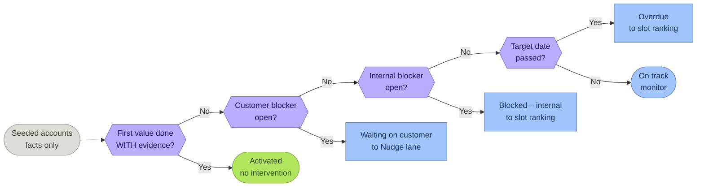
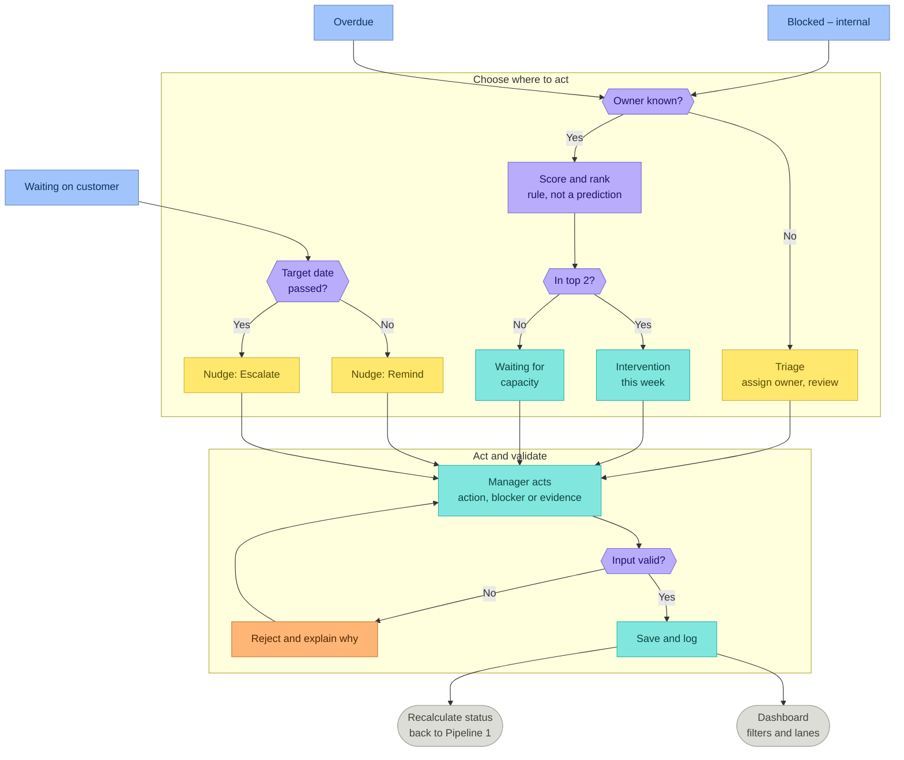

# Activation Desk – Pipeline

How the workbench turns account facts into a status, picks where to intervene this week, and validates every change. Status is never stored: it is recalculated from the facts after every saved change.

**Colors:** purple = automatic rule or decision · blue = account status · teal = manager action · yellow = Triage and Nudge lanes (no slot used) · orange = rejected input · green = activated · gray = input and output.

## Pipeline 1 – Status (first match wins)

**Flags** are shown next to the status: No owner, No next action, Past target. A passed target never changes *Waiting on customer*; it only adds the Past target flag.

## Pipeline 2 – Interventions and actions

### Priority score (0–100) – an explainable rule, not a prediction

Only accounts our team can unblock are scored. Customer-blocked accounts and accounts without an owner stop at a gate (Nudge lane or Triage) and never take an intervention slot.

| Component | Measures | Points |
|---|---|---|
| Urgency | Deadline consumption = (today − start) ÷ (target − start) | Overdue 50 · Critical (80%+ or ≤ 1 day left) 40 · Attention (50–80%) 20 · Comfortable (under 50%) 0 |
| Stagnation | Days the oldest internal blocker has been open | 0–2 days 0 · 3–5 days 10 · 6+ days 20 |
| Closeness to value | Pending activity milestones | 0 pending 20 · 1 pending 10 · 2+ pending 0 |
| Follow-up | Next action missing or follow-up date passed | 10 |

- **Tie-break:** urgency, then stagnation, then account name.
- **Unknown data** scores 0 and is shown as "not calculated", never estimated.
- **Fewer than 2 eligible accounts:** the slot stays empty with a message.

### Nudge lane

Customer-blocked accounts get a nudge level instead of points: **Remind** while the target is ahead, **Escalate** (customer owner + sponsor, propose a new target) once it has passed. The queue is ordered by deadline consumption. The app records the nudge; it never sends messages.

### Validation

Rejected with a clear message:

- activation without evidence, or not via the agreed workflow
- next action without owner or follow-up date
- customer blocker closed without a (simulated) customer update
- target date before start date

Resolving a blocker never activates an account. Only evidence does.
