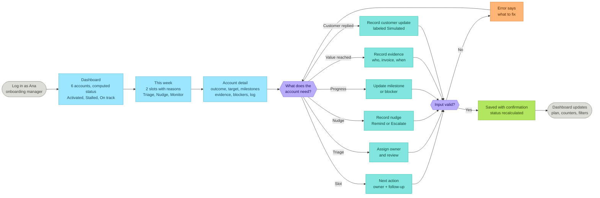
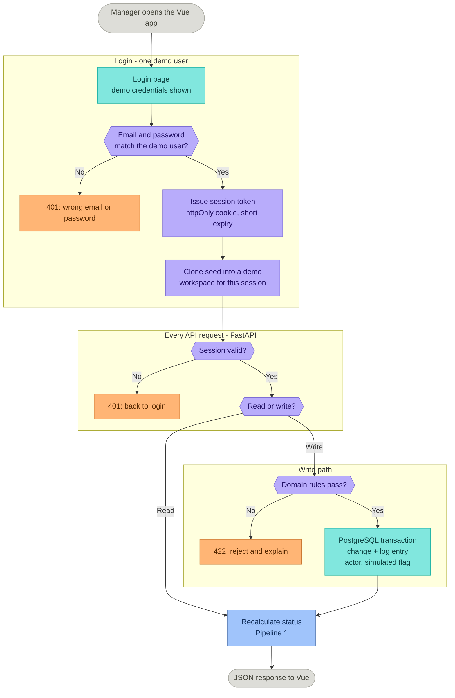
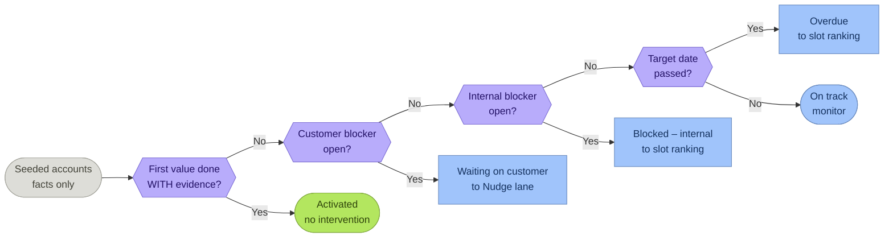
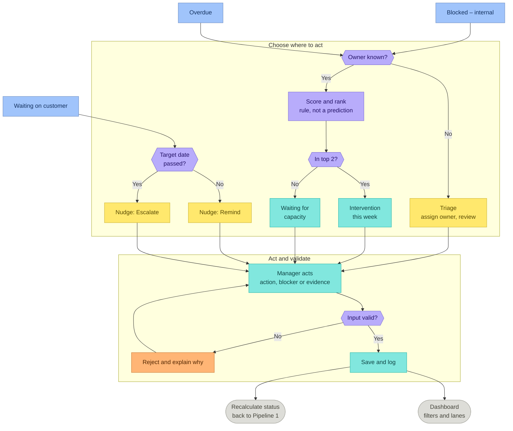

# Activation Desk – User journey and pipelines

Read in this order: **1. User journey → 2. Login and access → 3. Rules flow**. Status is never stored: it is recalculated from the account facts after every saved change.

**Colors:** cyan = screen the user sees · purple = automatic rule or decision · blue = account status · teal = user action · yellow = Triage and Nudge lanes (no slot used) · orange = rejected input or blocked access · green = activated or saved · gray = start, end and input.

## 1. User journey

The onboarding manager is the only user of the app. Customers and the head of CS do not log in.

### Onboarding manager (Ana): unblock 2 accounts this week and verify first value

### Customer finance lead: simulated, no login

The manager records customer-side blockers (side = customer) after a call or an email. When the customer delivers (for example, Beta sends the approval policy), she clicks **Record customer update (simulated)** on that blocker. It is the only way to close a customer blocker, and the log shows it as *Simulated*. Checking an internal task never closes it.

### Head of CS: the buyer, no login

Appears in the README as the buyer. Follows the outcome through the success metric: time to verified first value, plus the share of non-activated accounts that are Critical or Overdue. A read-only view for this role is a possible next step, not part of the prototype.

## 2. Login and access

### Pipeline 0 – Access and request flow (FastAPI)

One demo login: the onboarding manager. Every request checks the session, then the domain rules.

### Who does what (one demo user: the onboarding manager)

| Action | How it works in the app |
|---|---|
| See all 6 accounts and this week's plan | Dashboard with computed status, slots and lanes |
| Update an activity milestone | Manager records progress, even when the customer did the task |
| Record a blocker | Manager picks the side: internal or customer |
| Close an internal blocker | Manager records the internal fix |
| Close a customer blocker | Manager records the customer update, labeled Simulated. The only way to close it |
| Record next action | Owner and follow-up date required |
| Confirm first value | Manager records evidence: who approved, which invoice, when, via the agreed workflow |
| Reset demo data | Restores the 6 seeded accounts |

**Demo-only access, not production auth:** one seeded user (the onboarding manager), password hashed, credentials in the submission notes and on the login page. Each login gets its own demo workspace cloned from the seed, so reviewers never overwrite each other; reset restores the seed. Out of scope: other roles, sign-up, password reset, user management, permissions.

## 3. Rules flow

### Pipeline 1 – Status (first match wins)

**Flags** are shown next to the status: No owner, No next action, Past target. A passed target never changes *Waiting on customer*; it only adds the Past target flag.

### Pipeline 2 – Interventions and actions

### Priority score (0–100) – an explainable rule, not a prediction

Only accounts our team can unblock are scored. Customer-blocked accounts and accounts without an owner stop at a gate (Nudge lane or Triage) and never take an intervention slot.

| Component | Measures | Points |
|---|---|---|
| Urgency | Deadline consumption = (today − start) ÷ (target − start) | Overdue 50 · Critical (80%+ or ≤ 1 day left) 40 · Attention (50–80%) 20 · Comfortable (under 50%) 0 |
| Stagnation | Days the oldest internal blocker has been open | 0–2 days 0 · 3–5 days 10 · 6+ days 20 |
| Closeness to value | Pending activity milestones | 0 pending 20 · 1 pending 10 · 2+ pending 0 |
| Follow-up | Next action missing or follow-up date passed | 10 |

- **Tie-break:** urgency, then stagnation, then account name.
- **Unknown data** scores 0 and is shown as "not calculated", never estimated.
- **Fewer than 2 eligible accounts:** the slot stays empty with a message.

### Nudge lane

Customer-blocked accounts get a nudge level instead of points: **Remind** while the target is ahead, **Escalate** (customer owner + sponsor, propose a new target) once it has passed. The queue is ordered by deadline consumption. The app records the nudge; it never sends messages.

### Validation

Rejected with a clear message:

- activation without evidence, or not via the agreed workflow
- next action without owner or follow-up date
- customer blocker closed without a recorded (simulated) customer update
- target date before start date

Resolving a blocker never activates an account. Only evidence does.